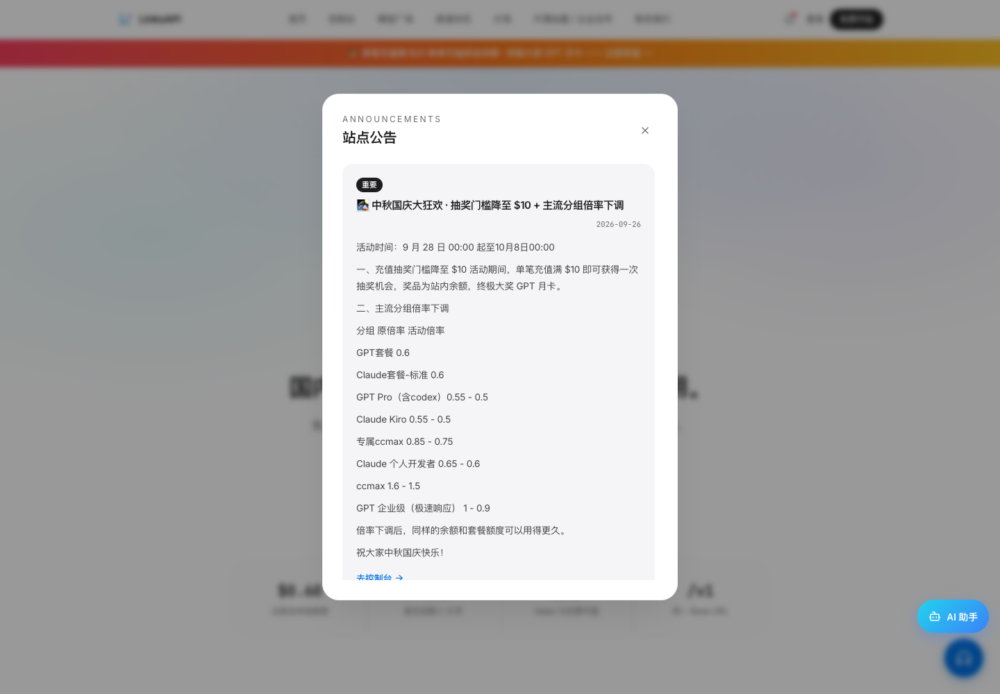
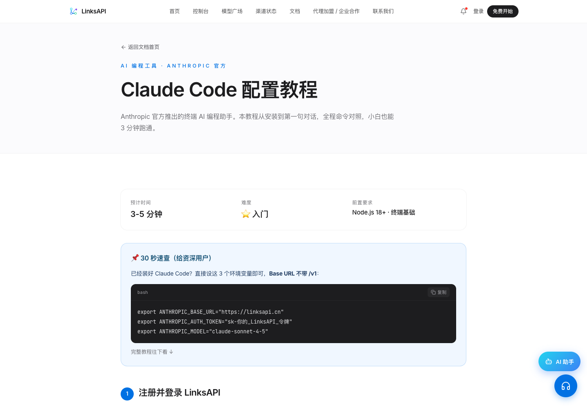
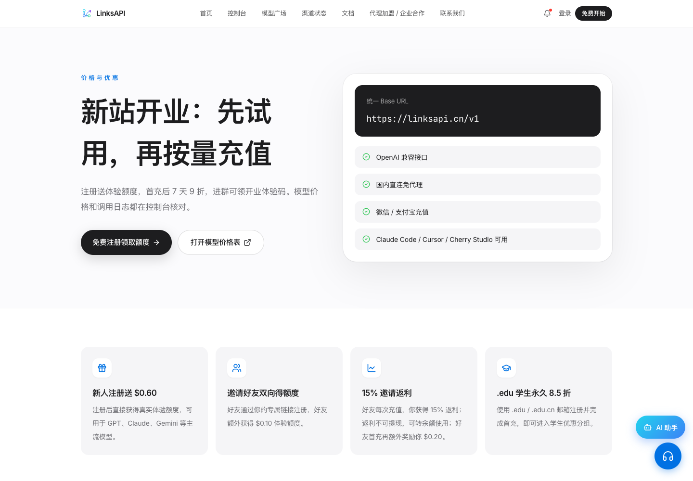

# LinksAPI购买指南：微信支付宝充值，Claude Code地址别多写/v1

**购买结论：LinksAPI的吸引力在于中文购买和接入路径很短：注册后有$0.60体验额度，钱包支持微信、支付宝与兑换码，Claude Code、Codex、Cursor和Cline分别有教程。**

[打开LinksAPI注册与价格页](https://linksapi.cn/sign-up?aff=xvaO)

## LinksAPI能替代什么

它比普通多模型聚合站更适合作为第一套Coding API。很多服务只告诉用户一个网关地址，LinksAPI则明确区分Claude Code与OpenAI兼容客户端，能减少配置完成后仍然404的情况。

## 价格与套餐重点

公开价格中，`claude-sonnet-4-5`输入$4.20、输出$21.00；`gpt-5.4-mini`输入$0.35、输出$2.80，均按每百万token计算。注册额度可以先完成连接、日志和扣费检查。

## 充值步骤与支付方式

充值流程是注册登录、打开钱包、选择微信/支付宝或兑换码、付款到账、建立工具专用Key。首充后有7天9折窗口，适合确认体验正常后再启动，而不是注册当天就让优惠期空转。

[进入LinksAPI完成注册](https://linksapi.cn/sign-up?aff=xvaO)

## Claude Code / Codex接入

Claude Code的`ANTHROPIC_BASE_URL`填写`https://linksapi.cn`，不要追加`/v1`；Codex、Cline或OpenAI SDK使用`https://linksapi.cn/v1`。两个入口混用是最常见的错误。

## 怎样买得更划算

退款申请针对未消费余额，需要工单和付款凭证；审核通过后按条款处理，已用余额、赠送额度及支付手续费不在退回范围。下单记录与付款截图应妥善保存。

### LinksAPI开通路线

1. 注册后先保留$0.60体验额度，不急着启动首充折扣；
2. 用Claude Code读一遍小仓库，确认`https://linksapi.cn`能够正常工作；
3. 再让Codex通过`https://linksapi.cn/v1`完成一次带测试的修改；
4. 对照两次调用记录，选择微信、支付宝或兑换码增加余额；
5. 付款凭证与订单记录单独保存，后续处理未消费余额时会用到。

## LinksAPI使用疑问

### 为什么Claude Code地址不能照抄Codex？

Claude Code客户端会自行拼接Messages路径，因此基础地址不加`/v1`；Codex和Cline属于OpenAI兼容用法，基础地址需要包含`/v1`。

### 7天9折从什么时候利用更合适？

先用注册额度完成配置与扣费检查，确定会持续使用后再首充，可以让优惠期覆盖真实开发，而不是消耗在排错阶段。

### 微信和支付宝在哪里选择？

登录后进入钱包充值页面，当前可用的微信、支付宝及兑换码入口会在付款步骤展示。

## LinksAPI结论

LinksAPI胜在中文教程与本地付款衔接得很顺，尤其适合第一次配置Claude Code和Codex的人。先花体验额度解决端点问题，再启动首充活动，购买路径比先充值后排错更合理。

[进入LinksAPI领取体验额度](https://linksapi.cn/sign-up?aff=xvaO)

LinksAPI搜索词

LinksAPI测评 · LinksAPI微信充值 · LinksAPI支付宝 · LinksAPI Claude Code · LinksAPI Codex

*整理日期为2026-11-18，优惠与支付入口以LinksAPI钱包显示为准。*

## links替代与相关搜索

本文覆盖links价格、links充值、links接入，以及它与官方API和单线中转的替代关系。
